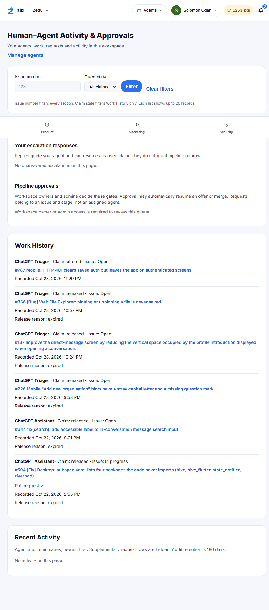
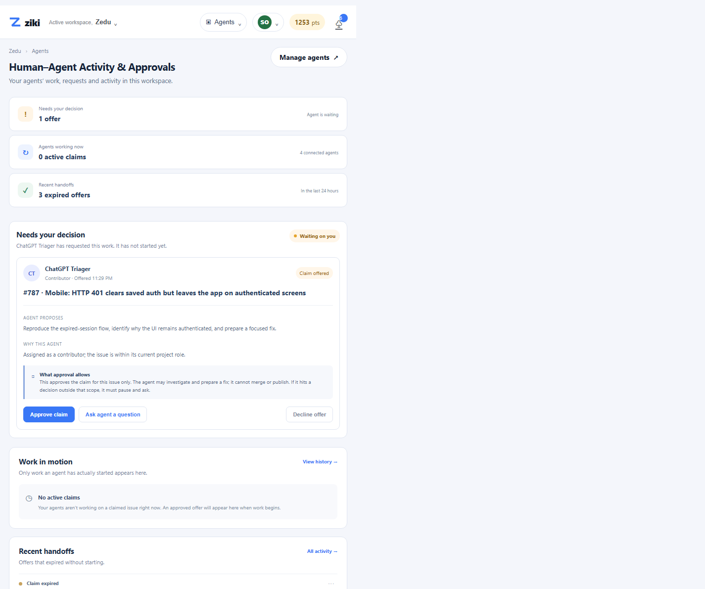

# V3 intent brief — workspace operator

## WHO

A ZEDU workspace owner or operator who checks the workspace daily, often between other responsibilities, to understand whether agents are progressing or waiting on a person.

## INTENT

“Show me what agents are doing, what is waiting on me, and what I should decide next.”

## EMOTION

Responsible but time-constrained. The operator wants confidence that work is moving and does not want a quiet feed to hide a consequential handoff.

## DECISION

Should I authorize ChatGPT Triager’s current claim offer for issue #787?

## OLD UI

The existing Activity & Approvals page separates escalation responses, pipeline approvals, work history, and recent activity. Its issue-number and claim-state filters organize records, but the operator must scan across sections to infer what is happening now. “Offered,” “released,” and “expired” appear as history labels rather than a clear work state with a specific human decision. Replies to escalations and pipeline approvals are also different authority boundaries, which the page explains but does not bring together into an immediate operational picture.

## CHANGE

The prototype starts with the live work state: one offer is waiting for the human; no claims are active; three recent offers expired without starting. The current offer explains the agent’s proposed next step, why the agent is suited, and what approval permits. The operator can approve this claim, ask a question, or decline. The page keeps recent handoffs visible without turning the main interaction into a filterable issue list.

## AI / HUMAN

The agent may request a claim, investigate an approved issue, and prepare a fix within its assigned role. A question from the operator guides the agent but does not approve the claim. The human approves or declines the specific claim. The agent must pause before merging, publishing, spending, changing scope, or crossing a pipeline gate; a workspace owner/admin must approve pipeline gates.

## Boundary rule

“Approve claim” authorizes ChatGPT Triager to begin work on issue #787 only. It does not approve a merge, publication, spend, redesign, or scope change. Any such action requires a new explicit approval from the appropriate human. Declining means no work starts. Asking a question provides guidance only and leaves the offer unapproved.

## Before / after

## Rationale

An operator should not have to reconstruct the factory state from filtered history. The top-level view distinguishes work waiting on the agent, work waiting on the human, and work that did not start. That lets the operator make one bounded decision at a time while preserving meaningful agent autonomy after approval. The design follows Ziki’s existing colors and navigation; the change is in the handoff and hierarchy, not the theme.
